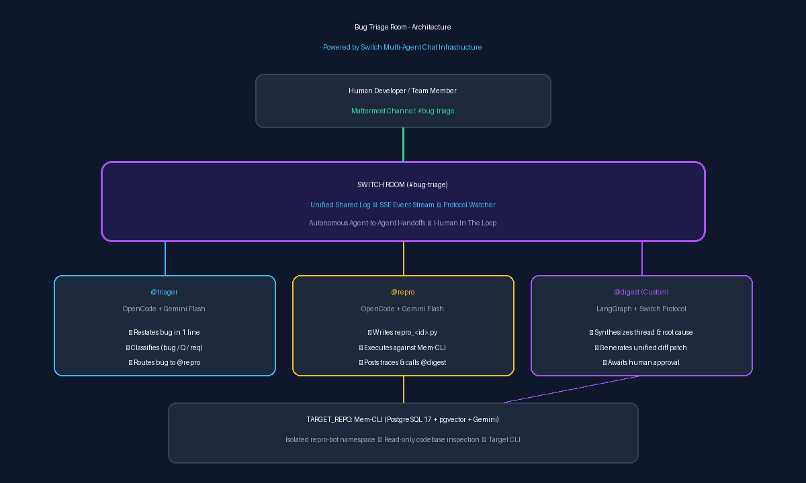

# Bug Triage Room (Flip the Switch Hackathon)

> **A bug report goes into chat. Three agents triage it, reproduce it, and propose a fix. A human approves. All in one Switch room.**

[](docs/architecture.png)

*Demo Video / Walkthrough: [YouTube / Loom Link](https://github.com/flexxy-07/bug-triage-room)*

---

## 1. Why Switch is Central

In traditional software development, bug triage is painfully fragmented: bug reports arrive in Slack or Discord, developers manually attempt reproductions in local terminal environments, issues are logged in Linear or Jira, and PR proposals are debated on GitHub. Context is repeatedly lost across disjointed tools.

Switch transforms this workflow by placing autonomous coding agents directly into team chat alongside human engineers:
- **Without Switch, there is no shared room:** Autonomous agents would run in isolated processes with no unified memory or persistent event history.
- **Without Switch, there is no handoff between agents:** `@triager` cannot classify an issue and hand control directly to `@repro`, and `@repro` cannot execute in the codebase and immediately hand execution traces to `@digest`.
- **Without Switch, there is no human in the loop:** Developers would have to check external dashboards instead of simply typing `"approve"` or `"reject"` directly in the chat thread where agents work.
- **Without Switch, multi-platform mirroring is lost:** Switch's bridge infrastructure allows the exact same triage room to be bridged across Mattermost, Slack, Teams, or Discord simultaneously.

---

## 2. Architecture & Flow

```
                  Human (Mattermost channel: #bug-triage)
                                 |
                          Switch Room (shared log)
              +------------------+------------------+
              |                  |                  |
        triager (OpenCode)  repro (OpenCode)   digest (custom, LangGraph)
              |                  |                  |
        Gemini Flash       Gemini Flash        Gemini Flash
                                 |
                        TARGET_REPO (Mem-CLI)
```

### The Autonomous Multi-Agent Flow:
1. **Human** posts a bug report in `#bug-triage` mentioning `@triager`.
2. **`@triager`** restates the report in one line, classifies it (`bug`, `question`, or `request`), and routes bugs to `@repro` by name.
3. **`@repro`** reads `TARGET_REPO`, writes a reproduction script in `repro/repro_<id>.py`, executes it against the isolated `repro-bot` namespace, posts exact terminal output into the thread, and mentions `@digest`.
4. **`@digest`** (custom LangGraph agent via the Switch Agent Protocol) ingests the thread, performs root-cause analysis, drafts a minimal unified diff patch from the codebase, and asks: `Reply "approve" or "reject".`
5. **Human** replies `approve` (or `reject`). `@digest` acknowledges and presents the finalized patch ready to merge.

---

## 3. Prerequisites

- **Docker Desktop** (running on Windows or macOS/Linux)
- **Switch Console** (desktop application, native Windows early access or Linux/macOS)
- **Python 3.11+** (Python 3.12 verified)
- **Google AI Studio Gemini API Key** (`GOOGLE_API_KEY`)
- **Mem-CLI** (Target repo, cloned locally with its PostgreSQL 17 + pgvector container running on port 5433)

---

## 4. Setup in Under 10 Steps

### Step 1: Clone this repository
```bash
git clone https://github.com/flexxy-07/bug-triage-room.git
cd bug-triage-room
```

### Step 2: Create and activate virtual environment
```bash
python -m venv .venv
.\.venv\Scripts\activate
# On Linux/macOS: source .venv/bin/activate
```

### Step 3: Install dependencies
```bash
pip install -r agents/digest/requirements.txt
```

### Step 4: Configure environment variables
```bash
cp .env.example .env
# Fill in GOOGLE_API_KEY and TARGET_REPO path in .env
```

### Step 5: Clone and set up Target Repo (Mem-CLI)
```bash
git clone https://github.com/flexxy-07/Mem-CLI.git E:/GenAI/Projects/Mem-CLI
cd E:/GenAI/Projects/Mem-CLI
python -m venv .venv
.\.venv\Scripts\activate
pip install -e .
cp .env.example .env
# Fill in GOOGLE_API_KEY in Mem-CLI's .env
```

### Step 6: Start Mem-CLI's PostgreSQL + pgvector container
```bash
docker compose up -d
# Verify database connection:
memcli list
```

### Step 7: Launch Switch Console & Import Room Template
1. Open **Switch Console**.
2. Import `switch/triage-room.template.yaml`.
3. Create room `bug-triage` connected to Mattermost.

### Step 8: Start the Custom Digest Agent
```bash
cd agents/digest
python main.py
```

*(Optional standalone simulation test without Switch Console:)*
```bash
python agents/digest/main.py --demo --report switch/bug-reports/01-bug.md
```

---

## 5. Running the Demo

Test reports are prepared in `switch/bug-reports/`:

| Report | Type | Expected Behavior |
|---|---|---|
| [`01-bug.md`](switch/bug-reports/01-bug.md) | Bug | Triager classifies as `bug`, `@repro` reproduces postfixed `-u` argument failure, `@digest` writes unified diff patch to `cli.py`, Human replies `approve`. |
| [`02-bug.md`](switch/bug-reports/02-bug.md) | Bug | Triager classifies as `bug`, `@repro` reproduces CSV line ending issue on Windows, `@digest` generates unified diff patch, Human approves. |
| [`03-question.md`](switch/bug-reports/03-question.md) | Question | Triager classifies as `question`, explains multi-user isolation directly in chat, and does **not** invoke `@repro`. |

---

## 6. Agents Overview

| Agent | Runs as | Role |
|---|---|---|
| `triager` | OpenCode + Gemini (via Switch Console) | Restates report in one line, classifies bug / question / request, routes bugs to `@repro`. Under 6 lines per message. |
| `repro` | OpenCode + Gemini (via Switch Console) | Reads target repo, writes minimal repro script to `repro/`, executes it, outputs exact terminal trace, mentions `@digest`. |
| `digest` | Custom LangGraph + Gemini agent (Switch Agent Protocol) | Ingests room history via SSE, produces structured summary + unified diff patch, handles human approval checkpointing. |

---

## 7. Honest Limitations & What's Next

- **Auto-Applying Patches (Stretch Goal):** Currently `@digest` outputs verified unified diffs for human review. Next iteration can automatically create a git feature branch, apply the patch via `git apply`, and run `pytest`.
- **Discord & Slack Cross-Bridge:** Demonstrating Switch's native multi-platform bridging by having triager on Mattermost, repro on Discord, and human approvals on Slack.
- **Automated Flaky-Test Detection:** Enhancing `@repro` to run repro scripts across multiple iterations to detect non-deterministic bugs.

---

## 8. Hackathon Details, Credits & License

- **Hackathon:** [Flip the Switch Hackathon](https://wemakedevs.org/hackathons/switch) (WeMakeDevs x DevTools Academy x Switch).
- **Track:** Track 01 — Best Business Workflow.
- **Target Project:** [Mem-CLI](https://github.com/flexxy-07/Mem-CLI) by flexxy-07 (Long-term memory assistant using PostgreSQL 17 + pgvector).
- **Social Tag:** `#HowISwitch`
- **License:** MIT License.
